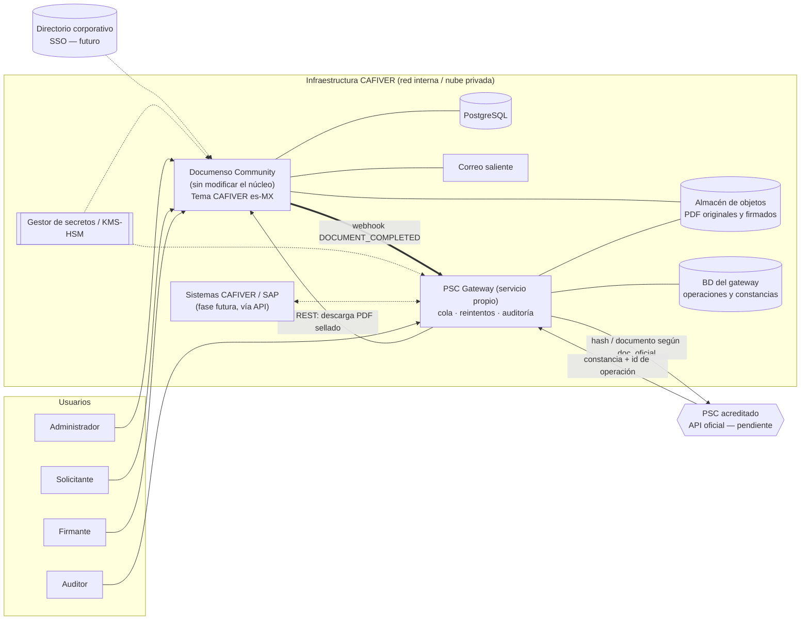

# Plataforma de firma electrónica CAFIVER — Arquitectura, integración PSC y camino a producción

> Diseño **conceptual**. No se han inventado endpoints, credenciales ni formatos del PSC: la integración real
> **no se implementa hasta recibir la documentación oficial del PSC seleccionado**.

## 1. Diagrama de arquitectura propuesta

Principios: (1) el núcleo AGPL no se modifica ni se enlaza con código propietario; (2) el gateway es un
programa separado que habla por HTTP; (3) ningún secreto en el repositorio ni en el navegador.

## 2. Flujo de extremo a extremo

1. Solicitante carga PDF y define firmantes/campos → estado `PENDING`.
2. Firmantes reciben enlace (+ verificación de identidad definida por política) y firman.
3. Documenso sella el PDF y emite `DOCUMENT_COMPLETED`.
4. Gateway recibe el webhook (verificando su firma/secreto), crea una **operación** con identificador interno idempotente.
5. Gateway obtiene el PDF final, calcula **SHA-256** y lo envía al PSC **conforme a su documentación oficial**.
6. Gateway guarda la constancia, fecha, resultado e identificador del PSC; relaciona los tres artefactos.
7. Auditor consulta y descarga evidencias; la UI muestra el estado de la constancia.

## 3. Diseño de la integración PSC (desacoplada)

### Modelo de datos del gateway (conceptual)
| Entidad | Campos clave |
|---|---|
| `operacion` | `id` (UUID, idempotencia), `envelope_id` (Documenso), `estado` (`PENDIENTE, ENVIADA, CERTIFICADA, ERROR, REINTENTO, FALLIDA`), `intentos`, `proximo_reintento`, `creada_en`, `resultado_en` |
| `documento_original` | `storage_key`, `sha256`, `bytes` |
| `documento_firmado` | `storage_key`, `sha256`, `bytes`, `envelope_id` |
| `constancia` | `storage_key`, `sha256`, `id_operacion_psc`, `fecha_emision_psc`, `resultado`, `psc_proveedor`, `version_api` |
| `evento_auditoria` | `operacion_id`, `tipo`, `actor` (sistema/usuario), `timestamp`, `detalle` (sin datos sensibles) |

Relación: `documento_original 1—1 documento_firmado 1—0..1 constancia` (la constancia referencia el **hash** del firmado).

### Requisitos transversales
| Tema | Diseño |
|---|---|
| Errores y reintentos | Cola persistente; reintento exponencial con tope y jitter solo para errores transitorios; errores definitivos → `FALLIDA` + alerta; **idempotencia** por `operacion.id` para no duplicar cargos |
| Auditoría | Bitácora append-only de cada transición; consulta restringida al rol Auditor |
| Credenciales | Solo en gestor de secretos/KMS; rotación; nunca en repo, logs ni front-end; mTLS/llaves según PSC |
| Consulta y descarga | Endpoint interno autenticado; URL prefirmada de corta vida; verificación de hash al descargar |
| Webhooks entrantes | Validar secreto/firma, rechazar reproducciones, límites de tasa |
| Datos enviados al PSC | **Mínimos necesarios** (idealmente solo el hash si el PSC lo permite); a definir con su documentación |
| Aviso | La constancia NOM-151 acredita conservación/integridad en un momento; **no sustituye** la identificación del firmante ni el mecanismo de firma aplicable |

### Información que debemos solicitar al PSC antes de implementar
Documentación oficial de la API y entornos de pruebas · qué se envía (documento/hash) y formato · autenticación ·
formato y verificación de la constancia · límites, SLA y tarifas · plazos de consulta/retención · acreditación vigente
ante la Secretaría de Economía · soporte para CSC (si se desea firma avanzada con llave en la nube).

## 4. Componentes reutilizados vs. desarrollos pendientes

| Reutilizado de Documenso (sin modificar) | Desarrollo pendiente |
|---|---|
| Carga/edición de PDF y campos, flujo multi-firmante, orden, plantillas | Tema y logotipo CAFIVER (modificación mínima o imagen derivada) |
| Sellado del PDF (local / HSM / CSC) y sello RFC 3161 | PSC Gateway + modelo de datos + cola |
| Certificado de firma y bitácora de auditoría | Vista de constancias NOM-151 (hoy fuera del producto) |
| Webhooks y API REST | Reportes de volumen y costo |
| Roles de organización/equipo y roles de destinatario | Rol "Auditor" (mapeo a MEMBER + permisos en gateway/reportes) |
| Correo, recordatorios, rechazo, expiración | Localización es-MX y textos legales |
| Primitivas de UI (shadcn/Radix + Tailwind) | SSO corporativo, integración SAP |

## 5. Requisitos para pasar de demostración a producción

**Legal / cumplimiento**
- Dictamen legal: tipo de firma exigible por documento (simple, avanzada/fiable), valor probatorio y rol de la NOM-151.
- Contratar un PSC acreditado y obtener su documentación oficial, entorno de pruebas y contrato.
- Decisión AGPL (cumplimiento de fuente) o licencia Enterprise; revisar frontera del gateway.
- Aviso de privacidad, política de retención y de identificación de firmantes.

**Técnicos**
- Entornos dev/QA/prod separados; IaC; HTTPS con certificados válidos; WAF.
- PostgreSQL con respaldos y restauración probada; almacén de objetos cifrado y versionado.
- Llave de sellado en HSM/KMS (no `.p12` en disco); gestión y rotación de secretos.
- SMTP corporativo con SPF/DKIM/DMARC.
- SSO/MFA para empleados; verificación de identidad de firmantes externos.
- Observabilidad (logs, métricas, alertas), proceso de parches y escaneo de dependencias.
- Pruebas de carga, de penetración y de recuperación ante desastres.
- Mantener un fork/parche mínimo y documentado de la marca; seguir versiones upstream.

**Organizativos**
- Responsables de plataforma, seguridad y soporte; matriz de roles (administrador, solicitante, firmante, auditor).
- Presupuesto: infraestructura, tarifa por constancia del PSC, EE si se requiere 2FA/SSO nativos.
- Piloto con un tipo de documento antes de ampliar.
